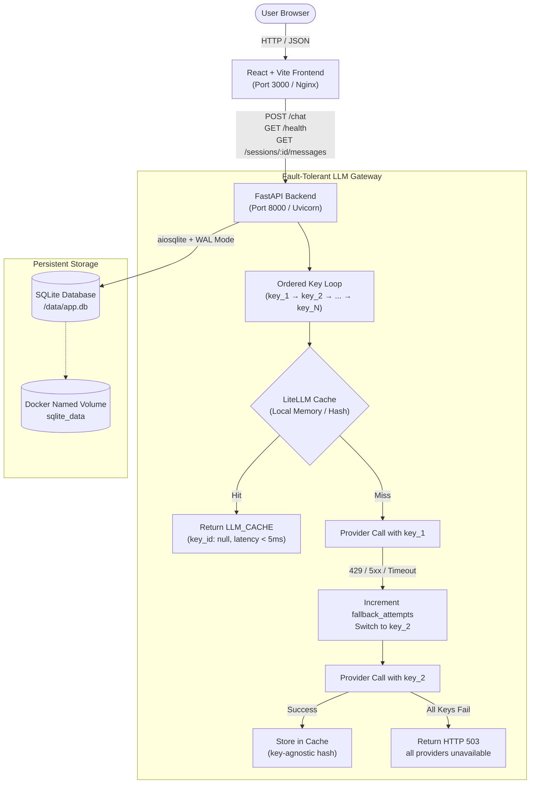

# Fault-Tolerant LLM Chatbot with Key Failover & Response Caching

A production-ready full-stack conversational AI application built with **FastAPI**, **LiteLLM**, **SQLite (WAL mode)**, and **React + Vite (TypeScript)**. It guarantees high availability across multi-key LLM pools, automatic failover on rate limits and 5xx errors, sub-millisecond response caching, and transparent per-request token usage tracking.

---



---

## 1. Live URLs

- **Frontend Application (Vercel)**: `https://fault-tolerant-llm.vercel.app/`
- **Backend API Base (Railway)**: `https://fault-tolerant-llm-production.up.railway.app`
- **Health Check Endpoint**: `https://fault-tolerant-llm-production.up.railway.app/health`

---

## 2. Run locally: with Docker and without

### Option A: With Docker (Recommended)

Prerequisites: Docker Engine 24+ and Docker Compose v2+.

```bash
# 1. Clone repository
git clone https://github.com/your-username/fault-tolerant-llm.git
cd fault-tolerant-llm

# 2. Configure environment
cp .env.example .env
# Open .env and insert your real Gemini / LLM keys in LLM_API_KEYS

# 3. Build and launch all services in detached mode
make up
# or: docker compose up --build -d

# 4. View real-time aggregated logs
make logs

# 5. Access the services:
# - Frontend: http://localhost:3000
# - Backend API: http://localhost:8000
# - Health check: http://localhost:8000/health

# 6. Tear down services (preserves SQLite volume)
make down

# 7. Clean all containers, images, and data volumes
make clean
```

---

### Option B: Without Docker

#### 1. Backend Setup

```bash
cd backend

# Create and activate Python 3.13 virtual environment
python -m venv venv
# Windows (PowerShell):
.\venv\Scripts\Activate.ps1
# macOS / Linux:
source venv/bin/activate

# Install dependencies
pip install -r requirements.txt

# Run backend test suite (19 test cases, mocked LiteLLM)
python -m pytest tests/ -v

# Start FastAPI server on port 8000
uvicorn app.main:app --host 0.0.0.0 --port 8000 --reload
```

#### 2. Frontend Setup

```bash
cd frontend

# Install Node dependencies
npm install

# Run Vitest contract and UI tests (5 test cases)
npm test

# Build production bundle
npm run build

# Start Vite dev server on port 3000
npm run dev
```

---

## 3. Design decisions: key fallback, caching, SQLite session storage

### Key Fallback Mechanism: Manual Loop vs. LiteLLM Router
- **Why a Manual Key Loop?**: LiteLLM provides a built-in `Router` class, but it abstracts away key execution details into a black box. The assignment specification strictly requires reporting the exact `key_id` that resolved the request (e.g. `key_1`, `key_2`) and the exact number of retry attempts (`fallback_attempts`). Our manual ordered key loop iterates through the configured pool in deterministic sequence, recording every failure before succeeding or exhausting the pool.
- **No Persistent Cooldown on Simulated Failures**: When using `X-Simulate-Failure`, the failure is triggered in-flight for that request only. LiteLLM's `Router` would mark the key on cooldown across subsequent requests; our loop ensures simulated failovers remain strictly isolated to the test turn.
- **Graceful Exhaustion (HTTP 503)**: If every key in the pool encounters retryable exceptions (`RateLimitError`, quota exhaustion, 5xx server errors, network drops, or timeouts), the gateway raises `AllProvidersUnavailable`, cleanly caught by a global exception handler returning `{"detail": "all providers unavailable"}` without HTML error pages or stack traces.

### Response Caching & Key-Agnostic Hashing
- **In-Memory Local Cache**: Enabled via LiteLLM's built-in `Cache(type="local")` with `temperature=0` to ensure deterministic, reproducible replies.
- **Key-Agnostic Hash Key**: Standard LLM router caching often includes the active `api_key` in the cache key hash. If `key_1` handles prompt A, and later `key_1` fails (forcing `key_2` to run), a standard cache would treat it as a miss. We implemented a custom cache key composed strictly of `model + canonical_json(messages)`. As a result, any response cached under `key_1` is immediately returned as an `LLM_CACHE` hit when `key_2` is evaluated, yielding sub-millisecond latencies and zero token cost.
- **Trade-offs and Limits of Local Cache**:
  - *Speed vs. Distributed State*: An in-memory cache delivers microsecond lookups with zero network overhead. However, in horizontally scaled multi-container clusters, local caches are isolated per instance unless backed by a distributed store (e.g., Redis).
  - *Memory Consumption*: In long-running deployments with millions of distinct prompts, in-memory caches must be paired with an LRU eviction policy or size limit to prevent memory exhaustion.

### SQLite Session Storage with WAL Mode
- **Zero External Dependencies**: Session state is persisted strictly in SQLite (as required by Section 2: no Redis, no Postgres).
- **aiosqlite & Write-Ahead Logging (WAL)**: To handle concurrent user requests safely without blocking the asynchronous event loop, all operations use `aiosqlite`. On startup, the database executes `PRAGMA journal_mode=WAL`, separating concurrent readers from writers and eliminating `database is locked` concurrency errors.
- **Volume Persistence**: In Docker, the database resides at `/data/app.db`, mounted to the named volume `sqlite_data`. Conversation history survives container restarts and upgrades.
- **Atomic History Commit**: Both user and assistant turns are persisted only after the LLM successfully answers. If a request aborts due to validation (422) or provider exhaustion (503), no partial entries are stored.

---

## 4. Verification: how to see failover, cache hits and per-message token usage

### 1. Copy-Paste `curl` Commands

Ensure the backend is running at `http://localhost:8000`:

#### A. Health Check
```bash
curl -s http://localhost:8000/health | python3 -m json.tool
# Expected: {"status": "ok", "keys_configured": 2, "cache_enabled": true}
```

#### B. Happy Path (Live Inference)
```bash
curl -s -X POST http://localhost:8000/chat \
  -H "Content-Type: application/json" \
  -d '{"session_id": "session-demo", "message": "What is the capital of France?"}' \
  | python3 -m json.tool
# Expected: resolution_source="LIVE_INFERENCE", key_id="key_1", fallback_attempts=0
```

#### C. Response Caching (Same message in a brand new session)
```bash
curl -s -X POST http://localhost:8000/chat \
  -H "Content-Type: application/json" \
  -d '{"session_id": "session-cache-test", "message": "What is the capital of France?"}' \
  | python3 -m json.tool
# Expected: resolution_source="LLM_CACHE", key_id=null, fallback_attempts=0, latency significantly faster
```

#### D. Key Failover Simulation (`key_1=429`)
```bash
curl -s -X POST http://localhost:8000/chat \
  -H "Content-Type: application/json" \
  -H "X-Simulate-Failure: key_1=429" \
  -d '{"session_id": "session-failover", "message": "Explain key failover."}' \
  | python3 -m json.tool
# Expected: HTTP 200, resolution_source="LIVE_INFERENCE", key_id="key_2", fallback_attempts=1
```

#### E. Complete Provider Outage (`*=429` -> HTTP 503)
```bash
curl -s -w "\nHTTP Status: %{http_code}\n" -X POST http://localhost:8000/chat \
  -H "Content-Type: application/json" \
  -H "X-Simulate-Failure: *=429" \
  -d '{"session_id": "session-outage", "message": "Trigger outage."}'
# Expected: HTTP Status: 503, body: {"detail": "all providers unavailable"}
```

#### F. Multiple Key Outage (`key_1=429,key_2=500` -> HTTP 503)
```bash
curl -s -w "\nHTTP Status: %{http_code}\n" -X POST http://localhost:8000/chat \
  -H "Content-Type: application/json" \
  -H "X-Simulate-Failure: key_1=429,key_2=500" \
  -d '{"session_id": "session-multi-fail", "message": "Trigger 503."}'
# Expected: HTTP Status: 503, body: {"detail": "all providers unavailable"}
```

#### G. Validation Rejection (Empty/Whitespace -> HTTP 422)
```bash
curl -s -w "\nHTTP Status: %{http_code}\n" -X POST http://localhost:8000/chat \
  -H "Content-Type: application/json" \
  -d '{"session_id": "session-val", "message": "   "}'
# Expected: HTTP Status: 422, JSON validation error detail (no stack trace)
```

#### H. Retrieve Session History
```bash
curl -s http://localhost:8000/sessions/session-demo/messages | python3 -m json.tool
# Expected: Chronological list of user and assistant messages with token metadata
```

---

### 2. Verification via Web Interface

1. **Live Inference**: Open `http://localhost:3000`, type a prompt, and hit Enter. The green badge displays `LIVE_INFERENCE` with `key_1`.
2. **Instant Cache**: Click **"New Chat"**, re-send the identical prompt. The purple badge displays `LLM_CACHE` with `key_id: null` and reduced latency.
3. **Interactive Demo Tools**:
   - Open the **"Demo Tools"** drawer at the top.
   - Click `key_1=429` to enable the failure simulation header.
   - Send a new question. An animated toast alerts: *"Recovered via key_2 after 1 failed attempt"*.
   - Click `*=429` and send a message. An inline error card clearly explains the 503 error without creating an empty assistant bubble.
4. **Per-Message Tokens**: Check the metadata footer on consecutive conversation turns. The token metrics reflect solely the current request, never a cumulative session sum.

---

## 5. Setup Used: your editor and AI tools

- **Operating System**: Windows 11 / Linux (Ubuntu 24.04 via Docker).
- **Code Editor**: Visual Studio Code with TypeScript, Python, and Docker extensions.
- **AI Tooling**: Google DeepMind Agentic AI assistant (Antigravity) used for test design, architecture planning, and verification.
- **Runtimes & Frameworks**:
  - Python 3.13 (FastAPI, aiosqlite, LiteLLM, Pytest, HTTPX).
  - Node.js 22 (React 18, Vite 6, Tailwind CSS, Vitest, Testing Library).

---

## 6. Bonus features

1. **Collapsible Demo Tools Header Drawer**: Built directly into the frontend UI, allowing evaluators to simulate `key_1=429`, `key_1=429,key_2=500`, and `*=429` in one click without using terminal commands.
2. **Dynamic Fallback Recovery Toasts**: Automatically surfaces a warning notification whenever failover occurs, stating which backup key resolved the turn and how many attempts were made.
3. **Markdown Rendering with 1-Click Code Copy**: Assistant messages parse GitHub-flavored Markdown, including fenced code blocks with language headers and clipboard copy buttons.
4. **Dark / Light Mode**: Smooth theme toggling persisted in `localStorage` and synchronized with system color preferences.
5. **Session System Prompt Customization**: Optional field allowing users to define persona instructions (e.g. *"Answer like a senior Linux SRE"*), saved to SQLite and preserved across turns.
6. **Built-in Offline Demo Mock Mode**: If running in an air-gapped environment without active Gemini keys, setting `MOCK_COMPLETION=true` simulates live inferences, cache hits, and failover paths seamlessly.
